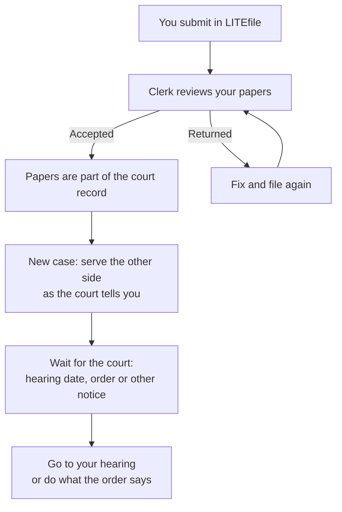

# What happens after you file

Submitting your papers is a big step. But your case is not done yet. Here is
what usually happens next.

## 1. The clerk reviews your papers

A court clerk checks that your papers are complete and filed in the right
place. The clerk does **not** decide who wins. The status page may show how
long review usually takes in your court.

- **Accepted:** Your papers are now part of the court record. Download the
  file-stamped copy. See [Check your filing status](./check-status.md).
- **Returned:** The clerk sent them back to fix. See
  [Fix a returned filing](./fix-returned-filing.md).

## 2. You get a case number (new cases)

If you started a new case, the court gives it a case number when it accepts
your papers. Write it down. You need it for everything you file later.

## 3. Serve the other side

In a new case, the other side must get official notice after you file. In an
existing case, you usually send copies when you file. LITEfile **does not** do
this for you. See [Send copies to the other side](./serve-papers.md).

## 4. Watch for a hearing date

The court may set a hearing. A hearing is a meeting with a judge, in person or
online. The court may send you a notice by mail or email, or the date may be on
your papers.

- Write the date and time down.
- Ask the clerk if you are not sure how to join.
- Go on time and bring your papers.

LITEfile does not schedule hearings.

## 5. Watch for orders and new papers

The judge may send an **order**. That is the judge's decision. The other side
may also file papers. Read everything you get. Look for deadlines.

## Keep a folder

Keep everything in one place:

- your confirmation number,
- the file-stamped copies,
- any notices or orders,
- notes about calls with the clerk.

## Need help?

Court help centers and legal aid can explain what comes next. See
[Get help](./get-help.md).
