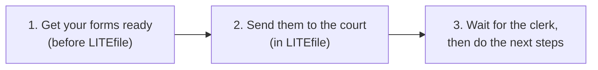
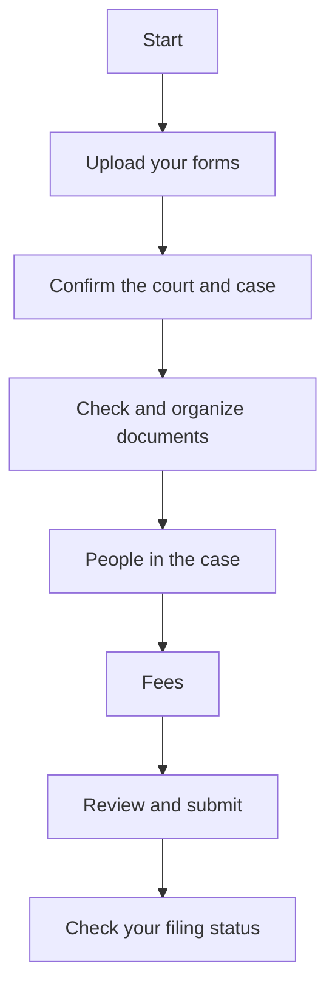

# How filing online works

LITEfile lets you send court papers to the court over the internet, instead of
taking them to the courthouse.

LITEfile works with courts in **Illinois**, **Massachusetts** and **Vermont**.

## Three big stages

Filing has three stages. LITEfile helps with the middle one.

1. **Get your forms ready.** Fill out and sign the right court forms first.
   LITEfile does not write your forms for you.
   [Learn where to get forms](./before-you-begin.md).
2. **Send them to the court.** Upload your forms to LITEfile. Answer a few
   questions. Pay the fee or ask for a waiver. Then submit.
3. **Wait, then take the next steps.** A court clerk checks your papers. You
   may need to send copies to the other side or go to a hearing.
   [See what happens after you file](./after-you-file.md).

## What you do in LITEfile

These are the screens you will see. You can go back and change things before
you submit.

## What LITEfile does not do

- It does not give legal advice or pick your forms for you.
- It does not fill in the court forms themselves.
- It does not send copies to the other people in your case.
- It does not set up hearings.

If you need help with these, see [Get help](./get-help.md).

## Where do you want to start?

- **I need forms.** [Get your forms ready first](./before-you-begin.md).
- **I'm not sure LITEfile can file my papers.** [Can I file here?](./can-i-file-here.md)
- **I have my forms. I'm ready.** [File step by step](./walkthrough.md).
- **I already filed.** [Check your filing status](./check-status.md).
- **The court sent my papers back.** [Fix a returned filing](./fix-returned-filing.md).
